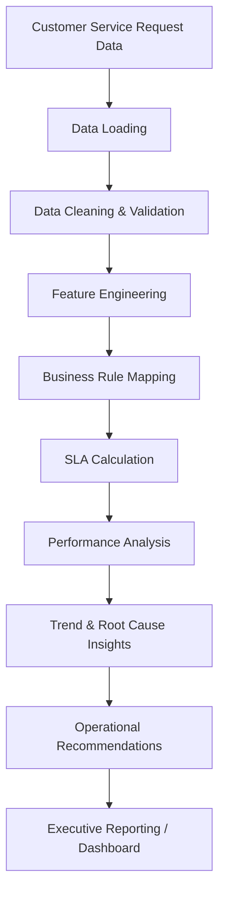
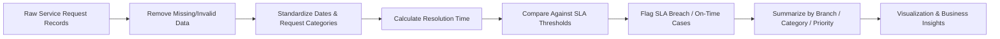
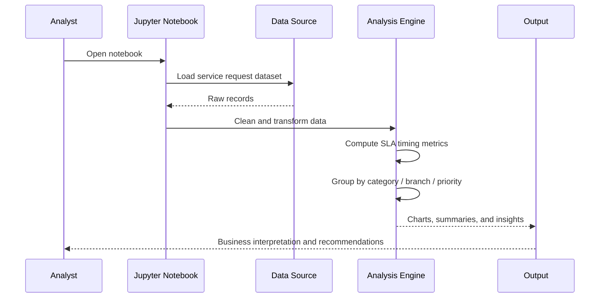

# HDFC Bank Service Request SLA Analyzer

This project analyzes customer service requests and tracks service-level agreement (SLA) compliance for HDFC Bank. It is implemented as a Jupyter Notebook workflow that ingests service request data, cleans and structures it, calculates SLA adherence, and highlights delays, resolution trends, and operational insights.

## Objective

The goal of this project is to help understand:

- Which service requests are taking longer than expected
- Which categories or branches are contributing to SLA breaches
- How resolution performance varies across time, segments, or request types
- What operational actions can reduce turnaround time and improve customer satisfaction

## Business Flow



## Proposed Analysis Pipeline



## Key Components

1. Data ingestion
   - Load service request data from the source file or dataset
2. Data preprocessing
   - Handle missing values, inconsistent records, and formatting issues
3. SLA logic
   - Compute resolution time and compare it with defined SLA limits
4. Segmentation analysis
   - Break down results by category, service type, branch, or priority
5. Insights and reporting
   - Identify bottlenecks, frequent delays, and improvement opportunities

## Typical Workflow in the Notebook



## Project Structure

```text
HDFC-Bank-Service-Request-SLA-Analyzer/
├── Copy_of_HDFC_Bank_Service_Request_Resolution_Analyzer_Student_Colab_Problem_Statement.ipynb
├── README.md
└── (optional datasets or supporting files)
```

## How to Use

### Option 1: Jupyter Notebook

1. Open the `.ipynb` file in Jupyter Notebook or JupyterLab.
2. Run the cells in order.
3. Review the generated output tables and visualizations.
4. Update the data path or parameters if you are using a different dataset.

### Option 2: Google Colab

1. Upload the notebook to Google Colab.
2. Mount Google Drive if your data files are stored there.
3. Run the notebook cells sequentially.

## Example Analysis Areas

- SLA compliance rate
- Average response and resolution time
- Top SLA breach drivers
- Branch-wise and request-type-wise performance
- Delay concentration by month or quarter
- Customer impact and resolution trend analysis

## Expected Output

The notebook can generate:

- Summary statistics
- Time-based trend charts
- SLA breach heatmaps or comparisons
- Category-wise insights
- Priority-based operational analysis

## Notes

This repository is primarily notebook-based, so the main logic and analysis flow live inside the Jupyter notebook. The README provides the project context, the business workflow, and a quick understanding of the end-to-end process.

## Next Steps

To extend the project further, you could add:

- A clean dataset folder
- CSV export of processed data
- An interactive dashboard (Power BI / Streamlit / Plotly)
- Business rule tuning for SLA thresholds
- Automated reporting for weekly/monthly reviews

If you want, I can also help create a more detailed README tailored to the exact notebook content once you share the notebook structure or a screenshot of the analysis sections.
